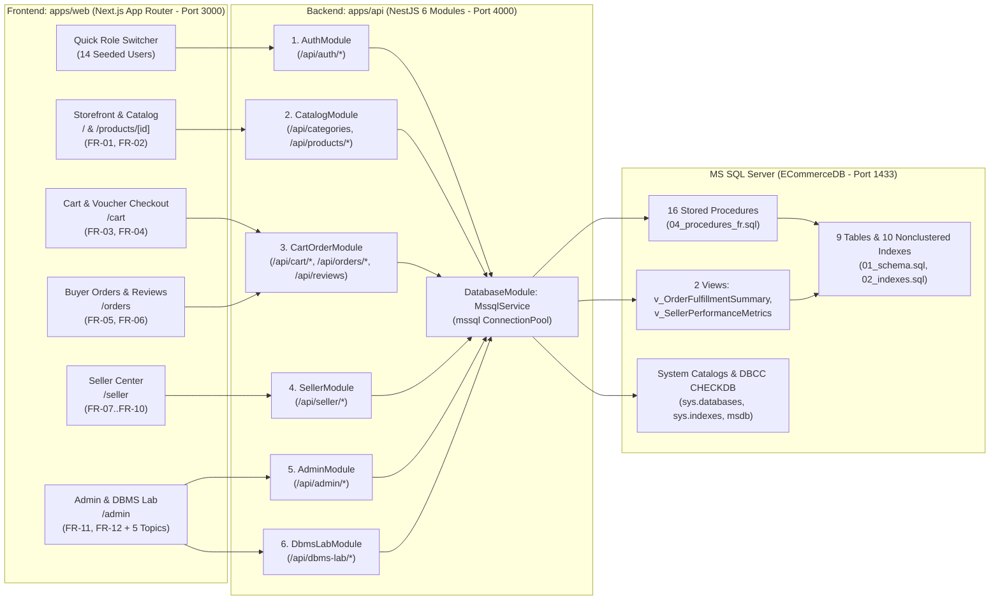

# TÀI LIỆU KIẾN TRÚC & ĐẶC TẢ MODULE WEB APPLICATION
## DỰ ÁN: SÀN THƯƠNG MẠI ĐIỆN TỬ ĐA GIAN HÀNG (MULTI-VENDOR E-COMMERCE PLATFORM)
**Môn học:** Hệ Quản Trị Cơ Sở Dữ Liệu (DBMS) – Học kỳ 261  
**Cơ sở dữ liệu sử dụng cho Web App:** Duy nhất **Microsoft SQL Server 2022/2025 (`ECommerceDB`)**  
**Kiến trúc triển khai (Phương án A):**
- **Frontend (`apps/web`):** Next.js 14 App Router, TypeScript, TailwindCSS, shadcn/ui style components (Port `3005`).
- **Backend (`apps/api`):** NestJS Modular REST API gồm 6 `@Module()` độc lập + `DatabaseModule` kết nối MS SQL Server qua `mssql` ConnectionPool (Port `4000`).

---

## 1. TỔNG QUAN KIẾN TRÚC HỆ THỐNG (3-TIER MODULAR ARCHITECTURE)

Theo yêu cầu đề bài (`Assignment_HK261_L01.pdf` / `docs/docs.md`), ứng dụng thực tế vận hành trên **1 Hệ quản trị CSDL duy nhất là Microsoft SQL Server (`ECommerceDB`)**. Toàn bộ cấu trúc dữ liệu tuân thủ tuyệt đối các tệp khởi tạo chuẩn trong `src/mssql/init/`:
- **`01_schema.sql`:** Khởi tạo CSDL `ECommerceDB` (`RECOVERY FULL`, `PAGE_VERIFY CHECKSUM`, `TARGET_RECOVERY_TIME = 60 SECONDS`) và **9 bảng quan hệ chuẩn hóa** (`Users`, `Sellers`, `Categories`, `Products`, `Cart_Items`, `Orders`, `Order_Details`, `Vouchers`, `Reviews`).
- **`02_indexes.sql`:** Thiết lập **10 Nonclustered & Covering Indexes** tối ưu hóa lọc đa điều kiện, truy vấn lịch sử đơn hàng và tổng hợp doanh thu.
- **`03_seed.sql`:** Nạp dữ liệu mẫu thực tế gồm **14 Users** (1 Admin, 5 Sellers, 8 Buyers), **5 Gian hàng**, **8 Danh mục đa cấp**, **24 Sản phẩm**, **6 Vouchers**, **12 Cart Items**, **16 Đơn hàng**, **22 Chi tiết đơn**, **16 Đánh giá** và tạo bản **Baseline Full Backup**.
- **`04_procedures_fr.sql`:** Định nghĩa kiểu bảng `dbo.TVP_OrderItem`, **2 Helper Views** (`v_OrderFulfillmentSummary`, `v_SellerPerformanceMetrics`) và **16 Stored Procedures** bao phủ trọn vẹn 12 Yêu cầu chức năng (`FR-01` $\rightarrow$ `FR-12`) cùng 8 dạng truy vấn (`a` $\rightarrow$ `h`).



---

## 2. CẤU TRÚC THƯ MỤC DỰ ÁN

```text
D:\Nam 4\Kì 1\DBMS\BTL\
├── apps/
│   ├── api/                                    # [Backend NestJS - Port 4000]
│   │   ├── src/
│   │   │   ├── common/filters/
│   │   │   │   └── sql-exception.filter.ts     # Ánh xạ mã lỗi T-SQL 50001..50010 sang HTTP Status
│   │   │   ├── database/
│   │   │   │   ├── database.module.ts
│   │   │   │   └── mssql.service.ts            # mssql ConnectionPool (Hỗ trợ Multiple Result Sets & OUTPUT)
│   │   │   ├── modules/
│   │   │   │   ├── auth/                       # Module 1: AuthModule (Danh sách 14 tài khoản & Đăng nhập)
│   │   │   │   ├── catalog/                    # Module 2: CatalogModule (FR-01, FR-02, FR-06 Stats)
│   │   │   │   ├── cart-order/                 # Module 3: CartOrderModule (FR-03, FR-04, FR-05, FR-06)
│   │   │   │   ├── seller/                     # Module 4: SellerModule (FR-07, FR-08, FR-09, FR-10)
│   │   │   │   ├── admin/                      # Module 5: AdminModule (FR-11, FR-12 Subquery BI)
│   │   │   │   └── dbms-lab/                   # Module 6: DbmsLabModule (Introspection 5 Topics & DBCC CHECKDB)
│   │   │   ├── app.module.ts
│   │   │   └── main.ts
│   │   ├── package.json
│   │   └── tsconfig.json
│   │
│   └── web/                                    # [Frontend Next.js App Router - Port 3000]
│       ├── src/
│       │   ├── app/
│       │   │   ├── layout.tsx                  # Root Layout + AuthProvider + Navbar
│       │   │   ├── page.tsx                    # Storefront & Lọc đa điều kiện (FR-01)
│       │   │   ├── products/[id]/page.tsx      # Chi tiết SP & Phân bố sao đánh giá (FR-02, FR-06)
│       │   │   ├── cart/page.tsx               # Giỏ hàng theo Shop, Voucher & Đặt hàng Transaction (FR-03, FR-04)
│       │   │   ├── orders/page.tsx             # Lịch sử đơn, Hóa đơn JOIN 5 bảng, Hủy đơn & Đánh giá (FR-05, FR-06)
│       │   │   ├── seller/page.tsx             # Seller Center: Thống kê Top 5, Quản lý SP/Kho, Duyệt đơn (FR-07..10)
│       │   │   └── admin/page.tsx              # Admin Portal: BI Subquery, Khóa User/Duyệt Shop & DBMS Lab (FR-11..12)
│       │   ├── components/
│       │   │   ├── navbar.tsx                  # Thanh điều hướng + Quick Role Switcher
│       │   │   └── dbms-badge.tsx              # Nhãn hiển thị [FR-xx | Query (a..h) | Stored Procedure]
│       │   └── lib/
│       │       ├── api.ts                      # REST Client gọi sang NestJS Backend
│       │       ├── auth-context.tsx            # Quản lý phiên tài khoản đang chọn
│       │       └── utils.ts
│       ├── package.json
│       └── tailwind.config.ts
│
├── src/
│   ├── mssql/
│   │   ├── init/                               # 01_schema.sql, 02_indexes.sql, 03_seed.sql, 04_procedures_fr.sql
│   │   └── backup/                             # 01_full_backup.sql .. 05_integrity_check.sql
│   ├── neo4j/                                  # init.cypher (Dùng riêng cho so sánh lý thuyết/CLI)
│   └── demo/                                   # run_demo.py
├── docs/                                       # Tài liệu đề bài (docs.md, project.md) & Báo cáo các thành viên
├── tools/                                      # Bộ kiểm thử pytest (tools/tests/) & scripts
├── docker-compose.yml                          # Container MS SQL Server 2022 (ecommerce_mssql)
├── package.json                                # Scripts chạy nhanh dev:api và dev:web
└── WEB_MODULES_DOCS.md                         # Tài liệu kiến trúc Web (file này)
```

---

## 3. ĐẶC TẢ CHI TIẾT 6 NESTJS MODULES & ÁNH XẠ CSDL `ECommerceDB`

### 3.1. Module 1: `AuthModule` (`apps/api/src/modules/auth`)
Phục vụ xác thực và chuyển đổi nhanh giữa **14 tài khoản có sẵn trong `03_seed.sql`** (`1 Admin`, `5 Sellers`, `8 Buyers`):
- `GET /api/auth/users`: Truy vấn `dbo.Users` `LEFT JOIN` `dbo.Sellers` lấy danh sách người dùng kèm `seller_id`, `shop_name`, `is_active`, `is_approved`.
- `POST /api/auth/login`: Đăng nhập theo `username` hoặc `email`, kiểm tra `is_active = 1`.

### 3.2. Module 2: `CatalogModule` (`apps/api/src/modules/catalog`)
Phụ trách **`FR-01`, `FR-02`** và thống kê sao **`FR-06`**:
| Endpoint | Mã FR & Dạng truy vấn | Đối tượng SQL thực thi | Mô tả kỹ thuật |
| :--- | :--- | :--- | :--- |
| `GET /api/categories` | Hỗ trợ `FR-01` | `dbo.Categories` (Self-join `parent_id`) | Trả về 8 danh mục phân cấp (4 danh mục gốc, 4 danh mục con). |
| `GET /api/products` | **`FR-01`**<br>Query **(e) Composite condition** | `EXEC dbo.sp_SearchProducts` | Lọc kết hợp `@keyword`, `@category_id` (bao gồm danh mục con), `@min_price`, `@max_price`, `@min_rating`, `@in_stock_only`, `@sort_by`. Tận dụng `IX_Products_status_price` & `IX_Products_category_id`. |
| `GET /api/products/:id` | **`FR-02`**<br>Query **(d) Single condition** | `EXEC dbo.sp_GetProductDetails` + `EXEC dbo.sp_GetProductRatingStats` | Nhận **2 Result Sets** từ `sp_GetProductDetails` (`recordsets[0]`: Thông tin SP & Shop; `recordsets[1]`: Danh sách Reviews) kết hợp phân bố 1–5 sao từ `sp_GetProductRatingStats`. |
| `GET /api/products/:id/rating-stats` | **`FR-06`**<br>Query **(h) Aggregate** | `EXEC dbo.sp_GetProductRatingStats` | Dùng `COUNT`, `AVG`, `SUM(CASE...)` thống kê số lượt đánh giá từ 1 sao đến 5 sao. |

### 3.3. Module 3: `CartOrderModule` (`apps/api/src/modules/cart-order`)
Phụ trách **`FR-03`, `FR-04`, `FR-05`, `FR-06`**:
| Endpoint | Mã FR & Dạng truy vấn | Đối tượng SQL thực thi | Mô tả kỹ thuật |
| :--- | :--- | :--- | :--- |
| `GET /api/cart` | **`FR-03`** | `dbo.Cart_Items` $\bowtie$ `Products` $\bowtie$ `Sellers` | Lấy danh sách sản phẩm trong giỏ của Buyer, gom nhóm theo từng `seller_id`. |
| `POST /api/cart/items` | **`FR-03`**<br>Query **(a) Insert / (c) Update** | `EXEC dbo.sp_AddToCart` | Kiểm tra `stock_quantity` khả dụng; nếu sản phẩm chưa có trong giỏ thì `INSERT`, nếu đã có thì `UPDATE` cộng dồn. |
| `DELETE /api/cart/items` | **`FR-03`**<br>Query **(b) Delete** | `EXEC dbo.sp_RemoveFromCart` | Xóa theo `cart_item_id`, `product_id` hoặc xóa toàn bộ giỏ (`@clear_all = 1`). |
| `GET /api/vouchers` | Hỗ trợ **`FR-04`** | `dbo.Vouchers` | Lấy 6 mã giảm giá (`WELCOME10`, `TECHSALE15`, `FREESHIP`, `FLASH25`, `BOOKWORM`, `FITNESS30`). |
| `POST /api/orders/checkout` | **`FR-04`**<br>Query **(a, b, c) Transaction** | `EXEC dbo.sp_PlaceOrder` (`@new_order_id OUTPUT`) | **Giao dịch ACID với `WITH (UPDLOCK, ROWLOCK)`**: Kiểm tra và cộng `used_count` của Voucher, trừ `stock_quantity`, cộng `sold_quantity`, chèn `Orders` & `Order_Details`, xóa `Cart_Items`. |
| `GET /api/buyer/orders` | **`FR-05`** | View `dbo.v_OrderFulfillmentSummary` | Lọc lịch sử đơn mua theo `buyer_id` và `order_status` (`IX_Orders_buyer_id_created_at`). |
| `GET /api/orders/:id` | **`FR-05`**<br>Query **(f) 5-Table JOIN** | `EXEC dbo.sp_GetOrderDetailsJoin` | Kết nối 5 bảng: `Orders` $\bowtie$ `Users` $\bowtie$ `Sellers` $\bowtie$ `Order_Details` $\bowtie$ `Products`. |
| `POST /api/orders/:id/cancel` | **`FR-05`**<br>Query **(c) Update Transaction** | `EXEC dbo.sp_CancelOrder` | Chỉ cho phép hủy khi đơn ở trạng thái `pending` hoặc `processing`; tự động hoàn trả `stock_quantity` và giảm `sold_quantity`. |
| `POST /api/reviews` | **`FR-06`**<br>Query **(a) Insert + (c) Update** | `EXEC dbo.sp_AddReview` | Kiểm tra đơn đã `delivered` và chưa đánh giá trùng; chèn đánh giá vào `dbo.Reviews` và tự động tính lại `Sellers.rating`. |

### 3.4. Module 4: `SellerModule` (`apps/api/src/modules/seller`)
Phụ trách **`FR-07`, `FR-08`, `FR-09`, `FR-10`**:
| Endpoint | Mã FR & Dạng truy vấn | Đối tượng SQL thực thi | Mô tả kỹ thuật |
| :--- | :--- | :--- | :--- |
| `GET /api/seller/products` | **`FR-07`, `FR-08`** | `dbo.Products` $\bowtie$ `dbo.Categories` | Lấy danh sách sản phẩm của Shop (`IX_Products_seller_id`) kèm cờ cảnh báo `is_low_stock`. |
| `POST /api/seller/products`<br>`PUT /api/seller/products/:id` | **`FR-07`**<br>Query **(a) Insert / (c) Update** | `EXEC dbo.sp_UpsertProduct` (`@product_id OUTPUT`) | Thêm sản phẩm mới khi `@product_id IS NULL` hoặc cập nhật sản phẩm hiện có của Shop. |
| `PATCH /api/seller/products/:id/inventory` | **`FR-08`**<br>Query **(c) Update** | `EXEC dbo.sp_AdjustInventory` | Cộng/trừ tồn kho nguyên tử (`@stock_delta`), chặn âm kho, tự động chuyển `status` giữa `out_of_stock` và `active`, trả về cảnh báo `is_low_stock`. |
| `GET /api/seller/orders` | **`FR-09`**<br>Query **(f) 4-Table JOIN** | `EXEC dbo.sp_GetSellerOrders` | Kết nối 4 bảng (`Orders` $\bowtie$ `Users` $\bowtie$ `Order_Details` $\bowtie$ `Products`) theo `@seller_id` và `@status`. |
| `PATCH /api/seller/orders/:id/status` | **`FR-09`**<br>Query **(c) Update** | `EXEC dbo.sp_UpdateOrderFulfillment` | Kiểm soát chuyển trạng thái đơn một chiều nghiêm ngặt: `pending` $\rightarrow$ `processing` $\rightarrow$ `shipped` $\rightarrow$ `delivered`. |
| `GET /api/seller/analytics` | **`FR-10`**<br>Query **(h) Aggregate** | `EXEC dbo.sp_GetSellerAnalytics` | Trả về **2 Result Sets**: (1) Tổng doanh thu, số đơn hoàn tất, tổng SP đã bán; (2) **Top 5 sản phẩm bán chạy nhất** của Shop. |

### 3.5. Module 5: `AdminModule` (`apps/api/src/modules/admin`)
Phụ trách **`FR-11`, `FR-12`**:
| Endpoint | Mã FR & Dạng truy vấn | Đối tượng SQL thực thi | Mô tả kỹ thuật |
| :--- | :--- | :--- | :--- |
| `GET /api/admin/users` | **`FR-11`** | `dbo.Users` `LEFT JOIN` `dbo.Sellers` | Danh sách toàn bộ 14 tài khoản người dùng trên hệ thống. |
| `PATCH /api/admin/users/:id/moderate` | **`FR-11`**<br>Query **(c) Update Transaction** | `EXEC dbo.sp_ModerateUserAccount` | Khóa/mở khóa tài khoản. Nếu khóa tài khoản gắn với Seller (`@is_active = 0`), Transaction tự động ẩn toàn bộ sản phẩm của Seller đó. |
| `GET /api/admin/sellers` | **`FR-11`, `FR-12`** | View `dbo.v_SellerPerformanceMetrics` | Thống kê hiệu suất, số sản phẩm, số đơn hoàn tất và doanh thu của cả 5 Gian hàng. |
| `PATCH /api/admin/sellers/:id/approve` | **`FR-11`**<br>Query **(c) Update** | `EXEC dbo.sp_ApproveSeller` | Phê duyệt hoặc thu hồi quyền hoạt động của Gian hàng (`is_approved`). |
| `GET /api/admin/analytics` | **`FR-12`**<br>Query **(g) Subquery + (h) Aggregate** | `EXEC dbo.sp_GetAboveAverageSellers` | Truy vấn các Gian hàng có doanh thu hoàn tất **lớn hơn mức trung bình toàn sàn** (`HAVING SUM(o.final_amount) > (SELECT AVG(shop_rev)...)`), kèm tổng GMV, hoa hồng sàn và sản lượng theo danh mục. |

### 3.6. Module 6: `DbmsLabModule` (`apps/api/src/modules/dbms-lab`)
Phục vụ trình diễn trực tiếp **5 Chủ đề lý thuyết & thực nghiệm DBMS** trên CSDL `ECommerceDB`:
- `GET /api/dbms-lab/introspection`:
  - **Chủ đề 1 (Data Storage & Management):** Truy vấn `sys.tables`, `sys.partitions`, `sys.allocation_units` hiển thị số trang 8KB (`total_pages`, `used_pages`) và đơn vị cấp phát (`IN_ROW_DATA`, `LOB_DATA`) của 9 bảng.
  - **Chủ đề 2 (Indexing Techniques):** Truy vấn `sys.indexes` hiển thị toàn bộ Clustered Index và 10 Nonclustered Covering Indexes (`Key Columns` & `Included Columns`).
  - **Chủ đề 3 & 4 (Query Processing & Transactions):** Danh mục 16 Stored Procedures và 2 Views trong `sys.objects`.
  - **Chủ đề 5 (Data Backup & Disaster Recovery):** Trạng thái `recovery_model_desc = FULL`, `page_verify_option_desc = CHECKSUM`, `target_recovery_time_in_seconds = 60` từ `sys.databases` và chuỗi LSN (`first_lsn`, `last_lsn`, `checkpoint_lsn`) từ `msdb.dbo.backupset`.
- `POST /api/dbms-lab/integrity-check`: Thực thi trực tuyến `DBCC CHECKDB ([ECommerceDB]) WITH NO_INFOMSGS, ALL_ERRORMSGS` (`05_integrity_check.sql`) và đo thời gian kiểm tra toàn vẹn trang 8KB.

---

## 4. HƯỚNG DẪN CÀI ĐẶT & CHẠY ỨNG DỤNG

### Bước 1: Khởi tạo CSDL MS SQL Server (`ECommerceDB`)
* **Cách 1 (Dùng Docker Container `ecommerce_mssql`):**
  ```powershell
  docker compose up -d --build mssql mssql-init
  ```
* **Cách 2 (Dùng trực tiếp SQL Server cài trên máy Windows):**
  ```powershell
  sqlcmd -S localhost -E -C -i "src\mssql\init\01_schema.sql"
  sqlcmd -S localhost -E -C -d ECommerceDB -i "src\mssql\init\02_indexes.sql"
  sqlcmd -S localhost -E -C -d ECommerceDB -i "src\mssql\init\03_seed.sql"
  sqlcmd -S localhost -E -C -d ECommerceDB -i "src\mssql\init\04_procedures_fr.sql"
  ```

### Bước 2: Chạy NestJS Backend (`apps/api` - Port `4000`)
```powershell
cd apps/api
npm install
npm run start:dev
```

### Bước 3: Chạy Next.js Frontend (`apps/web` - Port `3005`)
```powershell
cd apps/web
npm install
npm run dev
```
Truy cập ứng dụng tại: **`http://localhost:3005`**
