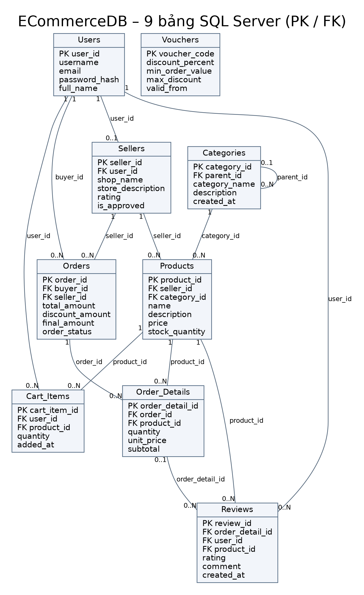
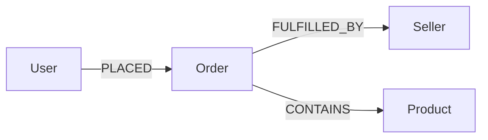
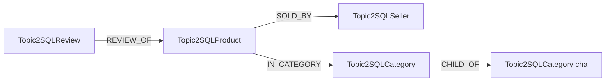

# CHAPTER 2 – SYSTEM REQUIREMENTS & DATABASE DESIGN

**Đề tài:** Multi-vendor E-Commerce Platform – HK261. **Phạm vi:** SRS và ERD của Thành viên 2; bảng a–h cần phối hợp TV3. Tài liệu phản ánh schema thực tế, không tự sửa yêu cầu của nhóm.

## 2.1. Mục tiêu và tác nhân

Hệ thống hỗ trợ nhiều gian hàng, người mua tìm kiếm/mua/đánh giá, người bán quản lý hàng hóa/đơn hàng và quản trị viên kiểm duyệt, thống kê toàn sàn. Ứng dụng sử dụng Microsoft SQL Server làm DBMS quan hệ chính; Neo4j phục vụ nghiên cứu đối sánh và minh họa mô hình đồ thị. Đề chính thức chỉ bắt buộc ứng dụng hoạt động trên ít nhất một trong hai DBMS.

## 2.2. Yêu cầu chức năng

| FR | Tác nhân | Yêu cầu theo SRS (tóm tắt) | Thành viên |
|---|---|---|---|
| FR-01 | Buyer | Tìm kiếm/lọc theo từ khóa, danh mục, giá, đánh giá, tồn kho; sắp xếp | TV2 |
| FR-02 | Buyer | Chi tiết sản phẩm, tồn kho và đánh giá | TV1 |
| FR-03 | Buyer | Thêm/sửa/xóa giỏ hàng | TV4 |
| FR-04 | Buyer | Đặt hàng, voucher, thanh toán, trừ kho | TV4 |
| FR-05 | Buyer | Theo dõi, lịch sử, hủy đơn khi được phép | TV5 |
| FR-06 | Buyer | Đánh giá 1–5 sao sau khi giao thành công | TV2 |
| FR-07 | Seller | Thêm/sửa, quản lý danh mục và trạng thái sản phẩm | TV1 |
| FR-08 | Seller | Nhập kho, cảnh báo tồn kho thấp | TV4 |
| FR-09 | Seller | Xử lý đơn, trạng thái và chi tiết giao hàng | TV5 |
| FR-10 | Seller | Doanh thu theo thời gian, top 5 sản phẩm | TV3 |
| FR-11 | Admin | Quản lý tài khoản, duyệt gian hàng | TV5 |
| FR-12 | Admin | GMV, hoa hồng, so sánh seller và ngành hàng | TV3 |

Đây là yêu cầu, không phải danh sách chức năng đã vượt qua kiểm thử. Đề yêu cầu số chức năng nghiệp vụ tối thiểu bằng hai lần số thành viên, không kể login/logout; SRS đặt ra 12 chức năng. Cột TV phản ánh bảng phân công gốc, cần đối chiếu với danh sách thành viên cuối cùng (PDF hiện tại liệt kê 4 người).

## 2.3. Ánh xạ tám thao tác DBMS

| Dạng | FR theo SRS | Ví dụ |
|---|---|---|
| a Insert | FR-03, FR-04; FR-06 theo phân công TV2 | Thêm giỏ hàng/đơn hàng/Review |
| b Delete | FR-03 | Xóa mục giỏ hàng |
| c Update | FR-04, FR-08 | Cập nhật kho khi đặt hàng/nhập kho |
| d Single condition | FR-02 | Tra cứu product_id |
| e Composite condition | FR-01 | Lọc danh mục, giá, kho |
| f Join | FR-05, FR-09 | Đơn hàng và chi tiết |
| g Subquery | FR-12 | Seller vượt mức doanh thu bình quân |
| h Aggregate | FR-06, FR-10 | AVG rating, COUNT review, SUM doanh thu |

## 2.4. Lược đồ quan hệ SQL Server

Nguồn: `src/mssql/init/01_schema.sql` trong `dbms-mssql(2).rar`. Có đúng 9 bảng vật lý; Cart_Items là bảng giỏ hàng, không có bảng Carts riêng. Sơ đồ chọn PK/FK và một số thuộc tính để dễ đọc; phần lược đồ bên dưới ghi đủ tên cột.

Mã nguồn sơ đồ: [ERD.dot](ERD.dot). Cạnh ghi tên FK; bội số biểu diễn ràng buộc schema, không mặc định các quy tắc nghiệp vụ chưa có constraint.

| Bảng | PK | FK | Thuộc tính khác |
|---|---|---|---|
| Users | user_id | — | username, email, password_hash, full_name, phone_number, address, role, is_active, created_at, updated_at |
| Sellers | seller_id | user_id → Users.user_id | shop_name, store_description, rating, is_approved, address, created_at, updated_at |
| Categories | category_id | parent_id → Categories.category_id | category_name, description, created_at |
| Products | product_id | seller_id → Sellers.seller_id; category_id → Categories.category_id | name, description, price, stock_quantity, sold_quantity, is_active, status, created_at, updated_at |
| Cart_Items | cart_item_id | user_id → Users.user_id; product_id → Products.product_id | quantity, added_at |
| Orders | order_id | buyer_id → Users.user_id; seller_id → Sellers.seller_id | total_amount, discount_amount, final_amount, order_status, shipping_address, payment_method, created_at, updated_at |
| Order_Details | order_detail_id | order_id → Orders.order_id; product_id → Products.product_id | quantity, unit_price, subtotal |
| Vouchers | voucher_code | — | discount_percent, min_order_value, max_discount, valid_from, expired_at, usage_limit, used_count |
| Reviews | review_id | order_detail_id → Order_Details.order_detail_id; user_id → Users.user_id; product_id → Products.product_id | rating, comment, created_at |

### 2.4.1. Quan hệ và ràng buộc

- Users–Sellers: Sellers.user_id UNIQUE; mỗi seller có một user, một user có 0 hoặc 1 seller. Users.username/email cũng UNIQUE.
- Categories tự tham chiếu parent_id (nullable); một danh mục có 0 hoặc 1 cha và có thể có nhiều danh mục con.
- Sellers–Products và Categories–Products: mỗi product có đúng một seller và category; phía cha có thể có nhiều product. Price, stock_quantity, sold_quantity không âm; status thuộc active/inactive/out_of_stock.
- Users–Cart_Items và Products–Cart_Items: bảng liên kết, UNIQUE(user_id, product_id), quantity > 0.
- Users–Orders, Sellers–Orders, Orders–Order_Details và Products–Order_Details: mỗi dòng chi tiết tham chiếu một order và product; UNIQUE(order_id, product_id).
- Users–Reviews và Products–Reviews: UNIQUE(user_id, product_id), rating 1–5. Reviews.order_detail_id nullable, không có UNIQUE trên riêng cột này; kiểm tra trùng theo order detail và trạng thái delivered nằm ở stored procedure, không phải FK.
- Vouchers: khóa voucher_code; các constraint kiểm tra mức giảm, thời hạn, giới hạn sử dụng. Không có FK từ Orders đến Vouchers trong schema hiện tại.

## 2.5. Neo4j: mô hình đồ thị và phạm vi

`src/neo4j/init.cypher` của nhóm tạo User, Seller, Product, Order với constraint ID; các cạnh PLACED, FULFILLED_BY, CONTAINS (quantity, unit_price) mô tả đơn hàng. Đây là đồ thị companion, chỉ có một tập con seed, không phải bản sao đầy đủ 9 bảng.

Đồ thị tham chiếu độc lập của TV2 lấy 24 Products, 16 Reviews, 5 Sellers, 8 Categories từ seed SQL; `python/04_seed_fr01_fr06_from_sql.py` tạo `Topic2SQL*`. Quan hệ: Product–SOLD_BY→Seller, Product–IN_CATEGORY→Category, Review–REVIEW_OF→Product, Category–CHILD_OF→Category (cha). Hai ảnh kết quả [FR-01](../results/fr_tests/fr01_composite_neo4j.png) và [FR-06 Aggregate](../results/fr_tests/fr06_aggregate_neo4j.png) cho thấy truy vấn tham chiếu trả lần lượt 3 sản phẩm và 2 đánh giá, trung bình 4,5 sao. Đây không phải minh chứng toàn bộ nghiệp vụ Web/API.

Benchmark tách riêng label `IndexDemoProduct` gồm 100.000 node; không yêu cầu graph nghiệp vụ để đo Index trên price, category_id/price và name. Các label Write chỉ phục vụ đo INSERT. Không đưa các thực thể thử vào ERD ứng dụng như bảng production.

## 2.6. Hai chức năng của Thành viên 2

**FR-01:** `sp_SearchProducts` JOIN Products/Sellers/Categories; kiểm tra khoảng giá, lọc active, tên/mô tả, category và con trực tiếp, seller rating, tồn kho và sort. Cơ chế hiện tại khác SRS ở hai điểm: chưa có cột brand riêng, tham số min_rating áp vào Seller thay vì điểm trung bình Product. Cần nhóm chốt thay đổi implementation hoặc cập nhật SRS; không tự báo đã đủ yêu cầu.

**FR-06:** `sp_AddReview` kiểm tra rating, quyền mua, delivered, không đánh giá trùng; INSERT Review và cập nhật Seller rating trong transaction. `sp_GetProductRatingStats` COUNT, AVG và phân bố 1–5 sao. Cypher tham chiếu chỉ minh họa đọc/tổng hợp. Thao tác thêm đánh giá được kiểm thử qua stored procedure SQL Server, không thay bằng benchmark INSERT.

Index ứng dụng (`IX_Products_status_price`, `IX_Reviews_product_id_rating`...) khác Index trên bảng thử riêng. Xem [báo cáo Topic 2 (mục 4.2 trong PDF Prism hiện tại)](Topic2_KetQua_BaoCao.md) và [kế hoạch kiểm thử](FR01_FR06_KiemThu.md).

## 2.7. Kiểm tra trước khi ghép báo cáo

Xác nhận cặp DBMS, xử lý khác biệt FR-01, kiểm thử FR-06 trên database thử, kiểm tra đường dẫn ứng dụng, thống nhất bảng a–h với TV3. Giữ kết quả benchmark SQL chưa chạy là chờ số liệu. Không coi tài liệu thiết kế là bằng chứng chạy ứng dụng.

## Nguồn nội bộ

1. Đề bài DBMS HK261 (`Assignment_HK261_L01.pdf`), mục 1.2 và yêu cầu a–h.
2. SRS – Sàn Thương Mại Điện Tử (Multi-vendor E-Commerce Platform), mục II–VI.
3. `Nhiệm vụ DBMS(5).xlsx`, hàng Thành viên 2 và Thành viên 3.
4. `dbms-mssql(2).rar`: `src/mssql/init/01_schema.sql`, `02_indexes.sql`, `03_seed.sql`, `04_procedures_fr.sql`, `src/neo4j/init.cypher` và `docker-compose.yml`.
