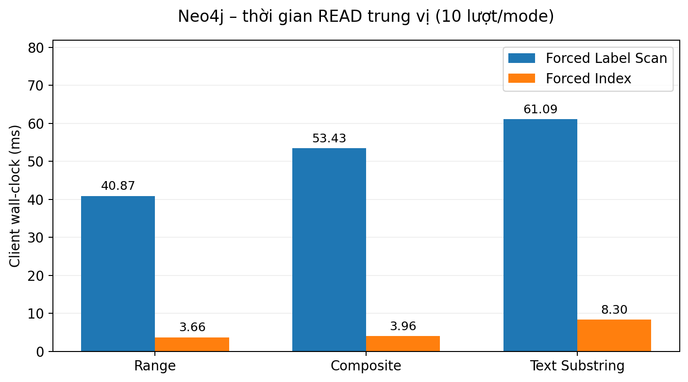
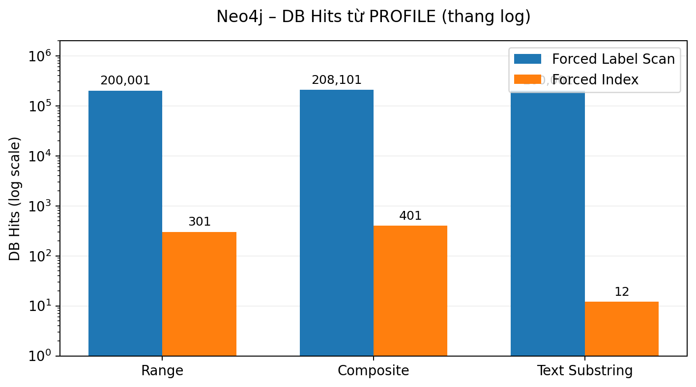
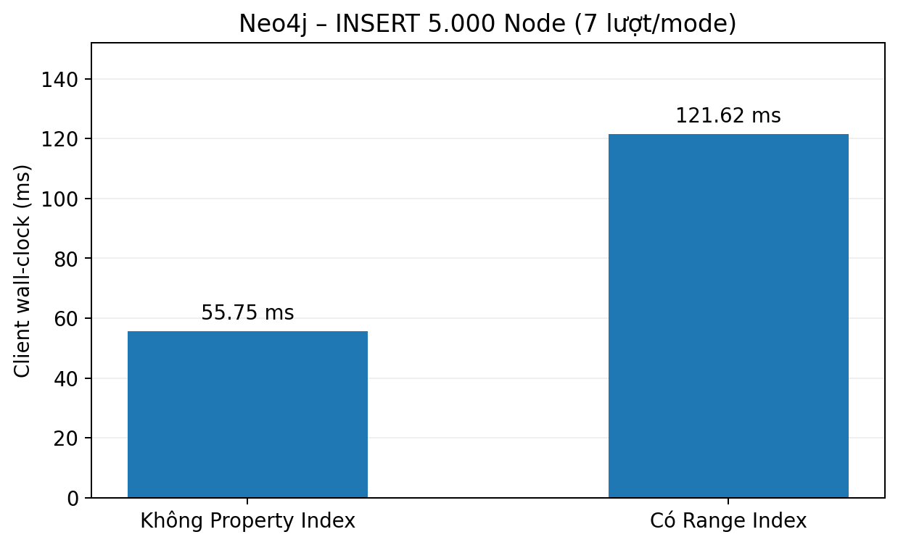

# CHAPTER 3 – TOPIC 2: INDEXING TECHNIQUES
## Đánh giá Indexing trên Microsoft SQL Server và Neo4j trong hệ thống E-Commerce

**Môn học:** Database Management Systems – HK261  
**Thành viên phụ trách:** Thành viên 2 – Indexing Techniques  
**Phiên bản tài liệu:** Rà soát 26/11/2026; kết quả Neo4j đã ghi nhận, kết quả SQL Server chờ thành viên SQL xác nhận.  
**Phạm vi:** FR-01 – Product Search & Multi-criteria Filtering; liên hệ thêm FR-06 – Product Review & Feedback.

> **Quy tắc kiểm chứng:** Các số đo Neo4j dưới đây được lấy từ `results/*.csv` và `evidence_original/*.txt` đã được kiểm tra; chưa chạy trực tiếp SQL Server để thu thập số liệu nên các ô SQL chưa được điền. Không suy luận hiệu năng từ dữ liệu ứng dụng chỉ có 24 Products.

## 1. Mục tiêu và câu hỏi nghiên cứu

Mục tiêu của Topic 2 là (i) phân tích ảnh hưởng của Index đến truy vấn theo khoảng giá, danh mục kết hợp giá và tìm chuỗi trong tên sản phẩm; (ii) phân tích đánh đổi đọc–ghi thông qua Write Overhead; (iii) đối chiếu các khả năng kỹ thuật trên SQL Server (hệ quan hệ) và Neo4j (hệ đồ thị thuộc tính); (iv) đánh giá mức độ phù hợp của các loại Index đối với FR-01 và FR-06.

Các câu hỏi chính: DBMS có sử dụng Index hay không? Số thao tác truy xuất dữ liệu thay đổi thế nào? Thời gian truy vấn qua cùng phương pháp đo thay đổi thế nào? Chi phí INSERT tăng bao nhiêu khi phải duy trì Index? Những khác biệt đó có ý nghĩa gì đối với ứng dụng thương mại điện tử đa người bán?

## 2. Hệ thống, dữ liệu và cấu trúc thử nghiệm

### 2.1. Cơ sở dữ liệu

| Thuộc tính | SQL Server – người phụ trách SQL | Neo4j – thực nghiệm hiện có |
|---|---|---|
| DBMS | Microsoft SQL Server 2022 theo Dockerfile nhóm; cần xác nhận phiên bản chạy thực tế | Neo4j Kernel **2026.10.1**, Neo4j Desktop 2.3.1, Cypher 25 |
| Nguồn chạy | `dbms-mssql(1).rar` – `src/mssql/init/*.sql` | Instance `DBMS_Topic2_Neo4j`, database `neo4j` |
| Dataset benchmark | `dbo.IndexDemoProducts` – chỉ có khi người SQL chạy script `sql_reference/01_mssql_create_100k.sql` | Label `:IndexDemoProduct` đã kiểm định **100.000 Node** |
| Số khóa duy nhất | Phải xác minh khi chạy SQL | **100.000 SKU duy nhất** |
| Cơ chế Index | Nonclustered Rowstore trên khóa tùy trường hợp | RANGE, composite RANGE và TEXT |
| Dataset ứng dụng | `dbo.Products`, `dbo.Reviews`, `dbo.Sellers`, `dbo.Categories` | Nhóm Label riêng `Topic2SQL*` (chỉ là seed tham chiếu, tùy chọn) |

**Không trộn dữ liệu:** benchmark 100.000 bản ghi là tập dữ liệu mô phỏng được tạo có kiểm soát. Seed ứng dụng gốc trong SQL có **24 Products, 16 Reviews, 5 Sellers, 8 Categories** và phục vụ nghiệp vụ. Hai tập này không thay thế nhau.

### 2.2. Công thức dữ liệu benchmark đối xứng

Với `i = 1..100000`:

- `sku = 'SKU-' + i`; `category_id = i % 20`.
- `price = 100000 + (i % 1000) × 1000`.
- `name = 'Laptop Model ' + i` nếu `i % 5 = 0`, ngược lại `name = 'Phone Model ' + i`.
- `description = 'Product description ' + i`; `is_active = true`.

Kết quả validation Neo4j đã xác nhận `total=100000`, `distinct_sku=100000`, `min_id=1`, `max_id=100000`, `invalid_rows=0` (chỉ số được trích từ SKU, không phải internal node ID). Cả ba Index chính đều `ONLINE`. Bên SQL cần tự xác nhận các điều kiện tương ứng trên dữ liệu do SQL tạo.

### 2.3. Các truy vấn đối chứng

| Case | Điều kiện nghiệp vụ | Số kết quả mong đợi ở hai phía | Index Neo4j |
|---|---|---:|---|
| Range | `price BETWEEN 154000 AND 156000` | **300** | `idx_demo_price` (RANGE) |
| Composite | `category_id=7 AND price BETWEEN 155000 AND 235000` | **400** | `idx_demo_category_price` (RANGE composite) |
| Substring Text | Tên chứa chính xác chuỗi `'Model 7777'` | **11** | `idx_demo_name` (TEXT) |

Trên SQL Server, các điều kiện có thể được viết bằng `BETWEEN`, `AND` và `LIKE N'%Model 7777%'`. Trên Neo4j dùng `WHERE` kết hợp toán tử số và `CONTAINS`. **Cảnh báo ngữ nghĩa:** SQL Server B-tree `name` thường không hỗ trợ Seek với dấu `%` ở đầu; Neo4j TEXT Index có thể hỗ trợ `CONTAINS`. Đây là đối chiếu cùng yêu cầu tìm chuỗi con, không phải hai thuật toán Index giống nhau.

## 3. Phương pháp thực nghiệm

### 3.1. Phân tích kế hoạch truy vấn (PROFILE)

Neo4j sử dụng `PROFILE` và các planner hint `USING SCAN`, `USING RANGE INDEX`, `USING TEXT INDEX` để minh họa hai đường truy xuất trên **cùng bộ dữ liệu**. Các Index đã tồn tại ở cả hai chế độ đo hiện tại. Vì vậy, tên gọi chính xác là **Forced Label Scan vs Forced Index**, không nên gọi là hoàn toàn không có Index so với đã tạo Index.

Rows là số dòng đầu ra của từng toán tử: NodeByLabelScan trả 100.000 dòng, Filter giữ 300/400/11 dòng tùy case; COUNT cuối trả một dòng. Trong hình và TXT, ghi nhận toán tử (`NodeByLabelScan`, `NodeIndexSeekByRange`, `NodeIndexSeek`, `NodeIndexContainsScan`), DB Hits, Rows và số lượng kết quả. `DB Hits` là chỉ số nội bộ của Neo4j, **không thể đồng nhất** với Logical Reads của SQL Server và **không phải** thời gian ms.

### 3.2. Benchmark thời gian truy vấn

`python/02_benchmark_read.py` thực hiện **3 lượt warm-up cho mỗi mode, 10 lượt đo cho mỗi mode**, đảo thứ tự scan/index theo vòng. Mỗi truy vấn trả một số đếm duy nhất, driver tải hết kết quả; thời gian tính bằng `perf_counter` ở phía Python client qua Bolt. Kết quả được thống kê bằng **trung vị (median)**, và số kết quả được đối chiếu với 300/400/11.

Định nghĩa:

`Speedup = Median(Scan_ms) / Median(Index_ms)`

Số đo là **client-observed wall-clock time**, không phải server execution time thuần. Kết quả phụ thuộc thiết bị, cache, driver và tiến trình hệ thống. Không dùng một phép đo `PROFILE` để tính speedup, vì PROFILE có chi phí instrument.

### 3.3. Benchmark Write Overhead

`python/03_benchmark_write.py` tạo hai nhóm Label độc lập: `Topic2WriteNoIndexBench` và `Topic2WriteWithIndexBench`. Mỗi lượt INSERT **5.000 Node** có cùng `value=1..5000`, `name='Product '+i`. Nhóm thứ hai duy trì một RANGE Index trên `value`. Sau một lượt warm-up, đo **7 lượt mỗi mode**, có luân phiên thứ tự; thời gian dọn dữ liệu và tạo Index không nằm trong khoảng đo INSERT. Chương trình chỉ tác động hai Label thử nghiệm riêng, không xóa 100.000 `IndexDemoProduct`.

**Giới hạn phương pháp:** đối chiếu phần trăm thay đổi *trong Neo4j* là hợp lý; không so trực tiếp các ms client-side này với số đo server-side của SQL Server nếu bên SQL đo bằng `DATEDIFF_BIG`.

## 4. Kết quả Neo4j đã xác minh

### 4.1. PROFILE – Chi phí truy xuất dữ liệu

| Thí nghiệm | DB Hits – Forced Label Scan | DB Hits – Forced Index | Kết quả | Toán tử khi dùng Index | Giảm DB Hits |
|---|---:|---:|---:|---|---:|
| Range | **200.001** | **301** | 300 | `NodeIndexSeekByRange` | **99,85%** |
| Composite | **208.101** | **401** | 400 | `NodeIndexSeek` | **99,81%** |
| Text Substring | **200.001** | **12** | 11 | `NodeIndexContainsScan` | **99,99%** |

**Căn cứ:** `results/profile_da_do_tu_TXT.csv` và 6 file TXT trong `evidence_original/{Range,Composite,Text}/`. Composite Scan ghi nhận **208.101** DB Hits. Mức giảm DB Hits được tính từ hai trạng thái plan, **không phải** tỷ lệ tăng tốc thời gian.

Kết quả cho thấy ở ba điều kiện được chọn, chỉ mục tương ứng giúp truy cập ít dữ liệu hơn đáng kể so với phương án quét nhãn. Điều này không chứng minh Index luôn hiệu quả cho tất cả truy vấn hay mọi tỷ lệ dữ liệu được chọn.

### 4.2. Benchmark READ – Thời gian trung vị

| Truy vấn | Scan median (ms) | Index median (ms) | Speedup (Scan/Index) | Số lượt mỗi mode |
|---|---:|---:|---:|---:|
| Range | **40,8664** | **3,6634** | **11,16×** | 10 |
| Composite | **53,4330** | **3,9587** | **13,50×** | 10 |
| Text Substring | **61,0870** | **8,3001** | **7,36×** | 10 |

**Nguồn:** `results/neo4j_read_runs.csv` (**60 lượt đo**) và `results/neo4j_read_summary.csv`. Trung vị đã được tính lại từ file runs và đối chiếu với summary. Trong tập thử này, cả ba Indexed Query đều có thời gian client-observed thấp hơn Forced Scan; không được diễn giải rằng SQL Server/Neo4j nào nhanh hơn khi chưa có số SQL tương ứng.

### 4.3. Benchmark WRITE – 5.000 Node / lượt

| Trường hợp | Median INSERT (ms) | Số lượt đo |
|---|---:|---:|
| Không có Property Index | **55,7479** | 7 |
| Có RANGE Index trên `value` | **121,6240** | 7 |

Tỷ số thời gian `With Index / Without Index` = **2,18×**. Trong điều kiện thử nghiệm này, thời gian INSERT tăng khoảng **118,17%** khi có Index. Đây là quan sát đo được trên 5.000 Node/lượt, không phải dự đoán áp dụng cho mọi loại truy vấn hoặc kích thước dữ liệu.

**Nguồn:** `results/neo4j_write_runs.csv` (**14 lượt đo**) và `results/neo4j_write_summary.csv`.

### 4.4. Kiểm tra sau benchmark

Sau khi chạy READ và WRITE, `python/01_validate.py` vẫn thông báo `PASS`: 100.000 Node, không trùng SKU, `invalid_rows=0`, ba Index chính `ONLINE`, và ba truy vấn trả 300/400/11. Như vậy dữ liệu chính không bị hỏng bởi benchmark Write trên các Label riêng.

### 4.5. Kiểm tra demo tự động và biểu đồ

`results/neo4j_demo_profile_current.csv` có 6/6 `plan_status=OK`; số kết quả và tổng DB Hits của từng plan khớp bảng 4.1. Kết quả này xác nhận lỗi đọc plan cũ đã được xử lý. Không cần thay CSV hoặc đo lại.

Các hình lấy từ CSV gốc; DB Hits không phải thời gian. READ/WRITE là client wall-clock. Tệp dump ngày 24/11 đã có trong `database/`; checksum và hướng dẫn phục hồi trong README, chưa có bằng chứng restore.

## 5. Đối sánh với Microsoft SQL Server – CHỜ DỮ LIỆU TỪ THÀNH VIÊN SQL

Bộ mã nguồn SQL của nhóm có các Index ứng dụng (`IX_Products_status_price`, `IX_Reviews_product_id_rating`...), nhưng các Index đó áp dụng cho bảng nghiệp vụ nhỏ. Để so sánh benchmark, phía SQL cần tạo **bảng thử riêng** `dbo.IndexDemoProducts` có cùng 100.000 bản ghi từ `sql_reference/01_mssql_create_100k.sql`. Các script 02 và 03 lấy Actual Execution Plan tự động trước/sau khi tạo ba Index thử, script 04 đo Write Overhead, script 06 đo READ lặp có planner hint với cả hai nhóm Index tồn tại. Script 06 dùng 3 warm-up và 10 lượt đo mỗi case/mode, tổng 60 lượt; thời gian server elapsed. Cần lấy riêng 6 Actual Plan của chính các truy vấn ép Scan/Index cuối script 06 để đối chiếu với bảng median; không nhầm chúng với plan tự động của 02/03. Các script benchmark **không chỉnh sửa** `dbo.Products` hay `dbo.Reviews`. Xem [hướng dẫn SQL](../sql_reference/README_SQL.md).

| Case | SQL Scan median (ms) | SQL Indexed median (ms) | SQL Logical Reads trước/sau | Neo4j Speedup |
|---|---|---|---|---:|
| Range | CHỜ SQL | CHỜ SQL | CHỜ SQL | 11,16× |
| Composite | CHỜ SQL | CHỜ SQL | CHỜ SQL | 13,50× |
| Text Substring | CHỜ SQL | CHỜ SQL | CHỜ SQL | 7,36× |
| Write Overhead | CHỜ SQL | CHỜ SQL | Không áp dụng | Neo4j thời gian với Index / không Index = 2,18× |

Sau khi nhận số liệu SQL, kiểm tra: (1) số kết quả 300/400/11 trùng nhau, (2) SQL thực sự sử dụng Index Seek hay Index/Table Scan, (3) cùng số lượt warm-up và repeat nếu so median, (4) vị trí đo thời gian (server hay client) được giải thích, (5) cấu hình và tình trạng cache được báo cáo. Chỉ sau đó mới đưa ra kết luận SQL–Neo4j có căn cứ.

## 6. Liên hệ chức năng ứng dụng FR-01 và FR-06

### 6.1. FR-01 – Tìm kiếm và lọc sản phẩm

Bên SQL Server, nhóm cài đặt `dbo.sp_SearchProducts` với các tham số `keyword`, `category_id`, `min_price`, `max_price`, `min_rating`, `in_stock_only`, `sort_by`. Phần Neo4j hiện có dữ liệu tham chiếu được trích từ seed SQL vào các Label **`Topic2SQL*`** riêng, không ghi đè `:Product` / `:Review` ứng dụng và không trộn với `IndexDemoProduct`.

Trên seed tham chiếu, điều kiện ví dụ `category_id=2`, giá 800–1600, Seller rating từ 4, tồn kho dương, trạng thái active trả **3 sản phẩm** theo ảnh kết quả [FR-01](../results/fr_tests/fr01_composite_neo4j.png), khớp seed: ID 3, 1, 2 với giá 899, 1199, 1299 và tồn kho 20, 45, 30. Đây là phép thử nghiệp vụ đối chứng cho một tập tham số, **không** khẳng định bao phủ toàn bộ các nhánh tìm kiếm từ khóa, danh mục con và sắp xếp mà stored procedure SQL hỗ trợ.

### 6.2. FR-06 – Đánh giá và thống kê

Bên SQL Server, `dbo.sp_GetProductRatingStats` tổng hợp số lượng/điểm sao; `dbo.sp_AddReview` kiểm tra người mua, đơn giao thành công, điểm 1–5, chống đánh giá trùng và cập nhật điểm Seller trong transaction. Graph tham chiếu chỉ minh họa **đọc/tổng hợp** đánh giá với quan hệ `(:Topic2SQLReview)-[:REVIEW_OF]->(:Topic2SQLProduct)`.

Với `product_id=9`, seed tham chiếu có **2 đánh giá** (5 và 4 sao), và ảnh kết quả [FR-06](../results/fr_tests/fr06_aggregate_neo4j.png) xác nhận `review_count=2`, `avg_rating=4,5`, một đánh giá 5 sao, một đánh giá 4 sao, các mức còn lại bằng 0. Nghiệp vụ Insert Review cần được kiểm thử trên SQL Server qua `sp_AddReview` theo [kế hoạch kiểm thử](FR01_FR06_KiemThu.md). Benchmark INSERT trên label thử không chứng minh chức năng FR-06 hoặc cơ chế đồng thời của ứng dụng.

### 6.3. Phân biệt ba phạm vi dữ liệu

1. `IndexDemoProduct`: 100.000 Node benchmark Indexing, **đã có trên máy**.
2. `Topic2SQL*`: dữ liệu nghiệp vụ tham chiếu nhỏ, **chỉ xuất hiện sau khi chạy** `python/04_seed_fr01_fr06_from_sql.py`.
3. `:Product`, `:Seller` của `src/neo4j/init.cypher`: graph companion sẵn có trong source SQL, **không được tự ý thay thế**.

## 7. Giới hạn thực nghiệm và nguy cơ sai kết luận

- Planner hints ép phương án truy xuất để minh họa tác động Index; Query Planner tự động có thể chọn một plan khác. Có thể chạy thêm `cypher/05_planner_auto.cypher` để minh họa lựa chọn tự động, nhưng phải trình bày kết quả đúng theo thực tế.
- SQL B-tree với `LIKE '%keyword%'` và Neo4j TEXT với `CONTAINS` dùng cơ chế khác nhau; so sánh ở đây là về khả năng hỗ trợ nghiệp vụ tìm chuỗi con, không phải cùng cấu trúc Index.
- DB Hits Neo4j và Logical Reads SQL Server có định nghĩa khác nhau, không thể so thẳng số lượng.
- Client-observed time Neo4j và server elapsed SQL không cùng phép đo. Đối chiếu tỉ lệ cải thiện *nội bộ* mỗi DBMS đáng tin hơn so sánh trị tuyệt đối từ hai máy khác cấu hình.
- Dữ liệu benchmark được sinh theo công thức, không mô phỏng đầy đủ phân phối dữ liệu thực tế. Cần thử thêm các độ chọn lọc khác nếu có thời gian.
- Kiểm tra ứng dụng FR-06 còn thiếu phần authorization và thao tác transaction đồng thời thực tế của hệ thống tích hợp; không được báo cáo là đã hoàn chỉnh khi chỉ chạy các truy vấn thống kê.

## 8. Kết luận hiện tại (trước khi nhận kết quả SQL)

Trên Neo4j Kernel 2026.10.1, cả ba loại Index được thử nghiệm đều có kế hoạch truy vấn phù hợp. Đối với bộ 100.000 sản phẩm được kiểm soát, việc dùng Index làm giảm rất mạnh DB Hits và giảm thời gian truy vấn client-observed so với ép quét nhãn. Ngược lại, phép đo INSERT 5.000 Node cho thấy duy trì một RANGE Index khiến thời gian ghi trong điều kiện thử nghiệm tăng khoảng 2,18 lần.

Do **chưa có kết quả benchmark SQL Server tương đương trong tài liệu này**, chưa đưa ra kết luận hệ quản trị nào vượt trội hơn về tốc độ tuyệt đối. Kết luận lựa chọn DBMS cuối cùng phải dựa thêm vào nghiệp vụ FR-01/FR-06, mô hình dữ liệu, khả năng truy vấn quan hệ, chi phí duy trì và benchmark của SQL Server.

## 9. Danh mục bằng chứng và khả năng tái lập

- `evidence_original/Range/`: `range_scan.txt/png`, `range_index.txt/png`.
- `evidence_original/Composite/`: `composite_scan.txt/png`, `composite_index.txt/png`.
- `evidence_original/Text/`: `text_scan.txt/png`, `text_index.txt/png`.
- `results/profile_da_do_tu_TXT.csv`: trích số DB Hits đã kiểm lại.
- `results/neo4j_read_runs.csv`, `results/neo4j_read_summary.csv`: 60 lượt đo và trung vị READ.
- `results/neo4j_write_runs.csv`, `results/neo4j_write_summary.csv`: 14 lượt đo và trung vị WRITE.
- `results/neo4j_environment.json`: môi trường benchmark READ.
- `python/01_validate.py`, `python/02_benchmark_read.py`, `python/03_benchmark_write.py`: mã tái lập phép thử.
- `python/05_demo_readonly.py` và `results/neo4j_demo_profile_current.csv`: demo PROFILE đã có 6/6 OK.

## 10. Tài liệu bổ sung và phạm vi kết luận

Bản lý thuyết gốc: [Topic2_Theory.pdf](Topic2_Theory.pdf). Phần lý thuyết dùng ví dụ Neo4j 5; môi trường đo thực tế là Cypher 25. Full-Text Search là mở rộng chưa có benchmark; không đồng nhất với Text Index. [Chapter 2 – SRS & ERD](Chapter2_SRS_ERD.md) mô tả schema thực và khác biệt với SRS. [Kiểm thử FR](FR01_FR06_KiemThu.md) ghi nhận hai truy vấn tham chiếu Neo4j đã có ảnh kết quả và kế hoạch kiểm thử SQL Server/Web còn lại. SQL Server phù hợp làm DBMS ứng dụng hiện tại vì source dùng bảng, FK và stored procedures cho giao dịch; Neo4j là lựa chọn đáng cân nhắc cho truy vấn chuỗi con và liên kết đồ thị. Đây là nhận định về kiến trúc và kết quả nội bộ Neo4j, không phải kết luận so tốc độ hai hệ.

## 11. Tài liệu tham khảo

1. Database Management Systems Assignment, Semester 261, mục 1.2 và tiêu chí Demonstration.
2. Tài liệu SRS – Multi-vendor E-Commerce Platform, FR-01, FR-06 và phần Topic 2.
3. Nhóm DBMS, `src/mssql/init/01_schema.sql`, `02_indexes.sql`, `03_seed.sql`, `04_procedures_fr.sql` (tài liệu mã nguồn nhóm).
4. Neo4j, [Index hints for the Cypher planner](https://neo4j.com/docs/cypher-manual/current/indexes/performance-indexes/index-hints/).
5. Neo4j, [Explore the query execution summary – Python Driver](https://neo4j.com/docs/python-manual/current/result-summary/).
6. Microsoft Learn, [SQL Server Index Architecture and Design Guide](https://learn.microsoft.com/en-us/sql/relational-databases/sql-server-index-design-guide).
7. Microsoft Learn, [SET STATISTICS IO](https://learn.microsoft.com/en-us/sql/t-sql/statements/set-statistics-io-transact-sql).
